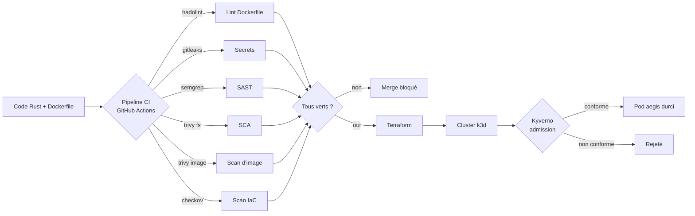

# Aegis : chaîne DevSecOps de bout en bout

[](https://github.com/sferrad/aegis/actions/workflows/ci.yml)

Aegis est un projet personnel qui construit, autour d'un petit service HTTP en Rust,
**toute la chaîne de sécurité** qu'on attend d'une équipe DevSecOps : une image durcie,
un pipeline CI qui refuse de livrer du code vulnérable, une infrastructure décrite en
code et scannée, et un cluster Kubernetes qui rejette les déploiements non conformes.

L'application est volontairement triviale. Ce qui compte, c'est **tout ce qu'il y a autour**.

## En chiffres

| | |
|---|---|
| Taille de l'image finale | **~9 Mo** (distroless, sans shell ni gestionnaire de paquets) |
| Contrôles de sécurité dans le CI | **6 jobs bloquants** (lint, secrets, SAST, SCA, scan d'image, scan IaC) |
| Scan de l'infrastructure (checkov) | **25 règles passées, 0 échec**, 2 exceptions justifiées |
| Politiques imposées au cluster | **2 ClusterPolicy Kyverno** en mode `Enforce` |
| Dépendances applicatives | **0** (surface SCA nulle par conception) |

## Architecture



## Les trois couches

### P1 : application et image durcie · [`p1/`](p1/)

- Build **multi-stage**, image finale **distroless** (`gcr.io/distroless/cc-debian12`)
- Exécution en **non-root** (uid `65532`), un seul port exposé
- Images de base **épinglées par digest** (`@sha256:...`) : build reproductible, aucun tag flottant
- **HEALTHCHECK** intégré au binaire lui-même (`/aegis healthcheck`), car l'image n'a ni shell ni `curl`
- Dockerfile **sans aucun avertissement** hadolint

### P2 : pipeline CI qui bloque les merges · [`p2/`](p2/)

Six jobs en parallèle à chaque `push` et `pull_request`, chacun avec un seuil de blocage
et un rapport conservé en artifact :

| Job | Rôle | Outil | Bloque si |
|---|---|---|---|
| `hadolint` | Qualité du Dockerfile | hadolint | toute erreur |
| `gitleaks` | Secrets dans le dépôt et son historique | gitleaks | tout secret détecté |
| `semgrep` | Analyse statique du code (SAST) | semgrep | toute trouvaille |
| `sca` | Dépendances vulnérables | trivy fs | HIGH ou CRITICAL |
| `image-scan` | CVE des paquets de l'image construite | trivy image | HIGH ou CRITICAL |
| `checkov` | Mauvaises configurations de l'IaC | checkov | toute règle en échec |

Une **branch protection** sur `main` impose une pull request et des checks verts :
une PR dont un scanner échoue ne peut pas être mergée.

### P3 : infrastructure et policy as code · [`p3/`](p3/)

- **Terraform** décrit le namespace et le Deployment dans le cluster
- Workload durci au niveau Kubernetes : `readOnlyRootFilesystem`, `allowPrivilegeEscalation: false`,
  `capabilities: drop ALL`, limites CPU/mémoire, probes de liveness et readiness
- **checkov** scanne le Terraform, en local et dans le CI
- **Kyverno** intercepte chaque admission et rejette tout Pod qui tourne en root ou sans limites de ressources,
  y compris ceux qui ne viennent pas de ce dépôt

## Démarrage rapide

Prérequis : Docker (P1, P2), puis k3d, kubectl et Terraform (P3).

```bash
# P1 : construire et lancer l'image durcie
cd p1 && make build && make run
curl localhost:8080/health          # {"status": "healthy"}

# P3 : cluster local, infra et politiques
k3d cluster create aegis
k3d image import aegis:0.1.0 -c aegis
cd p3/confs && terraform init && terraform apply
kubectl create -f https://github.com/kyverno/kyverno/releases/download/v1.13.4/install.yaml
kubectl apply -f policies/
```

Le détail de chaque étape, et les démonstrations où les contrôles **bloquent réellement**
(faux secret détecté par gitleaks, Pod root rejeté par Kyverno), sont dans les README de
[`p1/`](p1/README.md), [`p2/`](p2/README.md) et [`p3/`](p3/README.md).

## Choix et compromis assumés

La sécurité, c'est aussi savoir documenter ce qu'on n'applique pas, et pourquoi.

- **Seuils HIGH et CRITICAL** pour les scans de vulnérabilités : on bloque sur le grave,
  sans noyer le pipeline sous le bruit LOW et MEDIUM.
- **Une CVE ignorée, et documentée** dans [`.trivyignore`](.trivyignore) : faille OpenSSL de la base
  Debian 12 sans correctif publié. L'exception est justifiée et à réévaluer à chaque mise à jour de la base.
- **Deux règles checkov écartées**, avec justification dans le `main.tf` : le pin par digest et
  `imagePullPolicy: Always` n'ont pas de sens pour une image importée localement dans k3d.
  Ils seront appliqués avec le passage à un registry.
- **Scan d'image via la CLI Trivy** plutôt que l'action GitHub, pour éviter un cache de base CVE
  qui rendait les résultats non reproductibles.

## Prochaines étapes

- **P4 : registry et supply chain** : publication de l'image sur GHCR, déploiement épinglé par digest
- Déploiement de la même chaîne sur un cloud public (AWS)

## Structure du dépôt

```
aegis/
├── .github/workflows/ci.yml   # pipeline de sécurité (P2)
├── .trivyignore               # exceptions CVE documentées
├── p1/                        # application Rust + Dockerfile durci
├── p2/                        # documentation du pipeline
└── p3/                        # Terraform + politiques Kyverno
```
